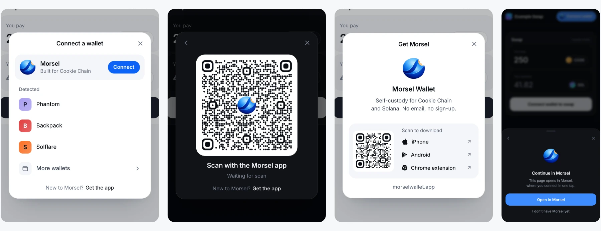

# @morsel-wallet/adapter

Connect a wallet to a dApp on **any SVM network**: Solana, Cookie Chain, Fogo, Sonic SVM, X1 and Solayer.
On the networks where Phantom and the others do not go, Morsel is the wallet; on Solana Morsel leads and
every Wallet Standard wallet (Phantom, Backpack, Solflare, …) still works.

One prop says which network your app is on. The wallet is told that network on every signature, signs
for it and refuses a transaction built for another one; a network the package does not know is refused
too, never taken for Solana.

- **Core** (`@morsel-wallet/adapter/core`, framework-agnostic): the network table (`SVM_CHAINS`), the
  Morsel adapter (injected extension, Morsel's in-app browser, and Morsel Connect, the encrypted QR relay
  to the Morsel phone app), a Wallet Standard adapter for every other wallet, Morsel Pay, typed errors.
- **React**: `WalletProvider`, `useChain`, `useWallet` and friends.
- **The Morsel connect widget**: a small, animated connect UI with Morsel as the hero, and a connect
  button that turns into an account chip carrying the network's mark.



## Install

```bash
npm install @morsel-wallet/adapter @solana/web3.js
```

React 18 or 19 (with `react-dom`) is needed only for the hooks and the widget.

## Quick start

```tsx
import { WalletProvider, WalletModalProvider, WalletModal, ConnectButton } from '@morsel-wallet/adapter';

export default function App() {
  return (
    <WalletProvider chain="fogo" autoConnect>
      <WalletModalProvider>
        <header>
          <ConnectButton />
        </header>
        {/* your app */}
        <WalletModal />
      </WalletModalProvider>
    </WalletProvider>
  );
}
```

`WalletProvider` creates the Morsel adapter and discovers every installed Wallet Standard wallet by
itself; the widget offers the ones that advertise your network. Pass `adapters={[...]}` to control the
list. Without `chain` the app is on Solana.

Then read and sign on that network:

```tsx
import { useChain, useWallet } from '@morsel-wallet/adapter';

const { chain, connection } = useChain();            // chain.name 'Fogo', a Connection to Fogo
const { publicKey, signAndSendTransaction } = useWallet();

const signature = await signAndSendTransaction(tx);  // Morsel signs and sends it on Fogo
console.log(chain.explorerTx(signature));
```

## Quick start per network

Every network is one key away. What changes is the key, the gas token and which wallets are offered.

**Solana**: Morsel first, then every Wallet Standard wallet that has Solana.

```tsx
<WalletProvider chain="solana">          {/* gas: SOL. Devnet: chain="solana-devnet" */}
```

**Cookie Chain**: Morsel's home network.

```tsx
<WalletProvider chain="cookie">          {/* gas: COOK */}
```

**Fogo**

```tsx
<WalletProvider chain="fogo">            {/* gas: FOGO. Testnet: chain="fogo-testnet" */}
```

**Sonic SVM** (the SVM network, not the EVM chain called Sonic)

```tsx
<WalletProvider chain="sonicsvm">        {/* gas: SOL */}
```

**X1**

```tsx
<WalletProvider chain="x1">              {/* gas: XNT */}
```

**Solayer** (InfiniSVM)

```tsx
<WalletProvider chain="solayer">         {/* gas: SOL; chain id solayer:mainnet */}
```

On a network where no other installed wallet is present, the widget says "Morsel supports Fogo" and
offers Morsel (the extension, its in-app browser, or the phone by QR).

Use your own RPC in production: the public endpoints below are rate limited.

```tsx
<WalletProvider chain="fogo" rpcUrl="https://your-fogo-node.example">
```

### The networks

| key | name | chain id the wallet receives | gas | public RPC | explorer |
|---|---|---|---|---|---|
| `solana` | Solana | `solana:5eykt4UsFv8P8NJdTREpY1vzqKqZKvdp` | SOL | https://api.mainnet-beta.solana.com | solscan.io |
| `cookie` | Cookie Chain | `solana:9wDaBRDgArEUpvhHxGguNkwozsZh4UpG` | COOK | https://rpc.cookiescan.io | cookiescan.io |
| `fogo` | Fogo | `solana:CDLtwKnaCoK157uaHQDj4fHu72AyD251` | FOGO | https://mainnet.fogo.io | fogoscan.com |
| `sonicsvm` | Sonic SVM | `solana:9qoRTAHGWBZHYzMJGkt62wBbFRASj6H7` | SOL | https://api.mainnet-alpha.sonic.game | explorer.sonicsvm.org |
| `x1` | X1 | `solana:4SvBP3omtvcCVWdxq1zBY5cDp4wndjsT` | XNT | https://rpc.mainnet.x1.xyz | explorer.mainnet.x1.xyz |
| `solayer` | Solayer | `solayer:mainnet` | SOL | https://mainnet-rpc.solayer.org | explorer.solayer.org |

Test networks: `solana-devnet`, `solana-testnet`, `fogo-testnet`, `sonicsvm-testnet`, `x1-testnet`.

A chain id is CAIP-2: `solana:` and the first 32 characters of the network's genesis hash. Solayer's
node has no real genesis hash, so it is named `solayer:mainnet`. Every other id that names a network
resolves too: the older Wallet Standard ids (`solana:mainnet`, `solana:devnet`, `gorbagana:testnet-v3`),
Backpack's 33-character form, the full genesis hash, and names such as `fogo:mainnet`.

```ts
import { SVM_CHAINS, svmChain, connectionFor } from '@morsel-wallet/adapter/core';

svmChain('fogo');                                      // the Fogo SvmChain
svmChain('solana:mainnet')?.key;                       // 'solana'
svmChain('solana:unknownchain00000000000000000000');   // null: unknown, never Solana
connectionFor('x1');                                   // a Connection to X1's public RPC
connectionFor('x1', 'https://your-x1-node.example', 'finalized');
```

Each `SvmChain` has `key`, `name`, `id`, `aliases`, `genesisHash`, `native` (`{ symbol, decimals }`),
`rpcUrl`, `explorerUrl`, `explorerTx(signature)`, `explorerAddress(address)`, `testnet` and `icon` (a
small SVG data URI of the network mark).

## Several networks in one app

```tsx
<WalletProvider
  chain="fogo"
  chains={['fogo', 'solana', 'x1']}
  rpcUrl={{ fogo: 'https://your-fogo-node.example', solana: 'https://your-solana-node.example' }}
  onChainChange={(chain) => localStorage.setItem('network', chain.key)}
>
```

```tsx
const { chain, chains, setChain, connection } = useChain();
setChain('solana');   // every adapter now signs for Solana; `connection` reads Solana
```

| Prop | Type | |
|---|---|---|
| `chain` | key, chain id or `SvmChain` | The app's network (default `'solana'`). A new value moves the app. |
| `chains` | array of the same | The networks the app offers. `setChain` is limited to them; the widget shows a network picker when there is more than one. Without it, any known network. |
| `rpcUrl` | string, `{ [key]: url }` or `(chain) => url` | Your RPC for reads (and for sends a wallet cannot do itself). A string is for the `chain` network only. |
| `onChainChange` | `(chain) => void` | After every change of network. |

An unknown network in `chain`, `chains` or `setChain` throws: it is a mistake in the app, and it is
never signed for as Solana.

## Signing on the right network

Every signature request names the app's network to the wallet:

- the Morsel extension and in-app browser get it as the provider's `network` argument;
- Wallet Standard wallets (Morsel's registration and every other) get it as `chain`: the id of that
  network the wallet advertises (Phantom is handed `solana:mainnet`, Morsel the CAIP-2 id);
- over Morsel Connect, the phone checks which network the transaction belongs to itself; the chain id
  rides along as optional metadata.

The wallet signs for that network and refuses a transaction built for another one. A Wallet Standard
wallet that does not advertise the network is refused before it is asked (`WalletChainNotSupportedError`,
"Phantom does not support Fogo").

```tsx
const { signTransaction, sendTransaction, signAndSendTransaction } = useWallet();
const { connection } = useChain();

await signAndSendTransaction(tx);                        // the wallet signs and broadcasts on the app's network
await sendTransaction(tx, connection);                   // the wallet signs; your connection sends
await signAndSendTransaction(tx, { chain: 'solana' });  // one request on another network
```

`signAndSendTransaction` lets the wallet broadcast through its own node (Morsel's checks the node's
genesis first); a wallet that cannot send itself signs, and the transaction goes out through the app's
connection. `useWalletBalance()` reads the app's network: `{ balance, symbol, loading, error, refetch }`.

## The connect widget

`<WalletModal />` renders the widget (it is the default `variant="compact"`). It is a 360 px card on
desktop and a bottom sheet you can drag down to dismiss on phones. Morsel is always first and works on
every network; another wallet is listed only when it advertises the app's network. What happens when
someone picks Morsel depends on where they are:

| Where | What happens when they pick Morsel |
|---|---|
| Desktop, Morsel extension installed | Connects through the extension: "Approve in Morsel". |
| Desktop, no extension | A branded QR to scan with the Morsel app. The code lasts 5 minutes; the countdown only shows in the last minute, and an expired code gets a new one in one tap. As soon as the phone scans it the widget switches to "Approve on your phone". |
| Phone browser | "Continue in Morsel": opens the page inside Morsel's browser through a universal link, where it connects in one tap. |
| Inside Morsel's browser | No list at all: it connects straight away. |

Other installed wallets that have the network are listed under Morsel ("Detected"); the rest sit behind
"More wallets". When no other installed wallet has the network, the widget says "Morsel supports Fogo."
and names the wallets that do not, yet. With more than one of `chains`, a compact network picker sits
under the title: one button naming the current network, opening the list of the app's networks in place
(arrow keys, Home/End, Esc back to the button). Declined requests, errors and expired QR codes each get
their own screen with a retry. "New to Morsel? Get the app" opens a short Get Morsel card.

The design is deliberately quiet: one accent action per screen, status screens with a single
heading, and nothing that loops except loading indicators.

### WalletModal props

All props are optional.

| Prop | Type | Default | |
|---|---|---|---|
| `variant` | `'compact' \| 'premium' \| 'headless'` | `'compact'` | `premium` is kept for compatibility and renders the widget. `headless` is the bare, unstyled list (filtered by network too). |
| `theme` | `'light' \| 'dark' \| 'system' \| 'auto'` | `'system'` | `system` follows the OS setting live. |
| `accentColor` | CSS colour | Morsel blue | Same as setting `--mw-accent`. |
| `placement` | `'center' \| 'anchor'` | `'center'` | `anchor` drops the widget down from the button that opened it (desktop). |
| `title` | `string` | `'Connect a wallet'` | Title of the wallet list. |
| `subtitle` | `string` | | Line under the title. |
| `logo` | URL or node | | Your dApp's logo, next to the title. |
| `networks`, `selectedNetworkId`, `onNetworkChange` | | | Your own network list for the picker, instead of `WalletProvider`'s `chains`. |
| `connectLabel` | `string` | `'Connect'` | Label of the Morsel action. |
| `installLabel` | `string` | `'Get'` | Label for wallets that are not installed. |
| `closeLabel` | `string` | `'Close'` | Accessible name of the close button. |
| `mobileDeepLink` | `string` | universal browse link | Override the "Open in Morsel" link on phones. |
| `links` | `{ install, ios, android, extension, website }` | Morsel's install page | Where the "Get Morsel" surfaces point. |
| `autoClose` | `boolean` | `true` | Close a moment after a successful connection. |
| `autoConnectInMorsel` | `boolean` | `true` | Inside Morsel's browser, connect without showing the list. |
| `showPoweredBy` | `boolean` | `false` | |
| `onConnectError` | `(error) => void` | | |
| `className`, `overlayClassName` | `string` | | Extra classes on the card and backdrop. |
| `zIndex` | `number` | `2147483000` | |
| `nonce` | `string` | | CSP nonce for the injected stylesheet. |

### ConnectButton

Without `className` or `children`, `ConnectButton` is the styled Morsel button: an accent pill that
opens the widget, then a compact account chip (avatar, wallet badge, the network's mark, short address
and, when you pass a `connection`, the balance in the network's gas token) with a menu to copy the
address, switch wallet or disconnect.

```tsx
const { connection } = useChain();
<ConnectButton connection={connection} theme="dark" />
```

| Prop | Default | |
|---|---|---|
| `theme`, `accentColor` | `'system'` | As on the widget. |
| `connection` | | A web3.js `Connection`; shows the balance in the chip. |
| `balanceSymbol` | the network's gas token | |
| `disconnectedLabel` | `'Connect wallet'` | |
| `connectingLabel` | `'Connecting…'` | |
| `showLogo` | `true` | The Morsel mark on the button. |
| `size` | `'md'` | `'sm'` for tight headers. |
| `useModal` | | `false` connects the active adapter directly instead of opening the widget. |

With `className` or `children` it keeps its original behaviour: an unstyled `<button>` you style
yourself, which disconnects when clicked while connected (`showAddress`, `connectedLabel` apply).

### Opening it from code

```tsx
const { open, close, visible } = useWalletModal();

open();                                  // wallet list
open({ view: 'get-morsel' });            // the Get Morsel card
open({ anchor: buttonRef.current });     // with placement="anchor"
```

### Theming and isolation

Every class is prefixed `mw-` and scoped under `.mw-scope`, so nothing leaks into your page and your
global `button` / `img` rules do not leak in. The stylesheet is injected once into `<head>` (pass
`nonce` for strict CSP, or ship `getMorselConnectCss()` yourself). Override any token from your CSS:

```css
.mw-scope {
  --mw-accent: #ff6b00;
  --mw-radius: 20px;
  --mw-font: inherit; /* use your page's typeface (the default is the system UI font) */
}
.mw-scope[data-mw-theme='dark'] {
  --mw-bg: #0b0b0f;
}
```

Tokens: `--mw-accent`, `--mw-accent-fg`, `--mw-bg`, `--mw-bg-2`, `--mw-bg-3`, `--mw-fg`, `--mw-fg-2`,
`--mw-fg-3`, `--mw-line`, `--mw-overlay`, `--mw-success`, `--mw-danger`, `--mw-warn`, `--mw-shadow`,
`--mw-radius`, `--mw-font`, `--mw-z`.

### Motion and accessibility

- Animations use only `transform` and `opacity`, through the Web Animations API and CSS; there is no
  animation library. The card height morphs between screens, the Morsel mark flies between them,
  lists stagger in and springs are real spring curves (`linear()` easing).
- `prefers-reduced-motion` turns every movement into a short fade.
- The widget is a labelled modal dialog with a focus trap, Esc to close, arrow keys through the
  wallet list, focus returned to the button on close, and live regions for status changes.
- SSR: nothing touches `window` during render; the widget mounts on the client through a portal.

## Morsel Pay

Take payments in USDC, USDT, SOL or COOK, paid straight from the customer's wallet to yours (Morsel's
fee rides in the same transaction; Morsel never holds the money).

1. On your server, create a checkout with your secret key:

```bash
curl https://api.dumpsack.xyz/v1/pay/checkout/sessions \
  -H "Authorization: Bearer sk_live_…" -H "Content-Type: application/json" \
  -d '{"amount":"30","token":"USDC","description":"Gold, 1 month","success_url":"https://shop.example/thanks"}'
# → { "id": "cs_…", "url": "https://morselwallet.app/checkout/cs_…", … }
```

2. In the page, the button (or the function):

```tsx
import { MorselPay } from '@morsel-wallet/adapter';

<MorselPay
  checkout={() => fetch('/api/checkout', { method: 'POST' }).then((r) => r.json()).then((j) => j.id)}
  onPaid={(r) => console.log('paid', r.signature)}
  onError={(e) => console.warn(e.code, e.message)}
/>
```

```ts
import { morselPay } from '@morsel-wallet/adapter/core';

const result = await morselPay({ checkout: 'cs_…', wallet /* optional, any Solana wallet adapter */ });
```

With a wallet connected the customer approves one transaction right in your page (Morsel shows its
simulation and Morsel Guard first); without one the hosted checkout opens in a popup (Pay with Morsel, or
any Solana wallet by QR). The promise resolves once Morsel has seen the payment on chain, never because a
wallet said it sent something. Errors carry a `code`: `expired`, `closed`, `rejected`, `not_found`,
`aborted`, `timeout`, `network`. `useMorselPay()` gives the same with `status` for your own UI.

Your server learns it too, from the signed `checkout.session.completed` webhook: trust that, not the page.

### Subscriptions

A recurring charge, paid each period straight from the customer's wallet on the wallet's own recurring
rails: USDC on Solana, COOK on Cookie Chain. The customer approves it once in Morsel and stops it there.

```bash
curl https://api.dumpsack.xyz/v1/pay/subscriptions \
  -H "Authorization: Bearer sk_live_…" -H "Content-Type: application/json" \
  -d '{"network":"solana","amount":"9.99","interval":"month","cycles":12,"description":"Gold"}'
# → { "id": "sub_…", "url": "https://morselwallet.app/subscribe/sub_…", "status": "incomplete", … }
```

Send the customer to `url`. Webhooks: `customer.subscription.created` once it is set up, `invoice.paid`
(with the payment) for every period, `customer.subscription.deleted` when it ends or is stopped.

The checkout's network decides where it is paid (`payChainOf(checkout)`, from `SVM_CHAINS`): the wallet is
asked to sign for that network even when your page is on another one. A network the table does not know
is refused (`MorselPayError` with `code: 'network'`), never paid on Solana.

## Morsel adapter (core)

Without React:

```ts
import { MorselWalletAdapter, connectionFor } from '@morsel-wallet/adapter/core';

const morsel = new MorselWalletAdapter({ chain: 'fogo' });
await morsel.connect();
const signature = await morsel.signAndSendTransaction(tx);           // on Fogo
await morsel.sendTransaction(tx, connectionFor('fogo'));             // signed for Fogo, sent by you
morsel.setChain('x1');                                               // later requests are for X1
```

`MorselCookieWalletAdapter` is the same class under its 0.1–0.3 name. Built without a `chain`, the
adapter passes no network, and the wallet signs for its own (0.3 behaviour). Every other wallet:
`new StandardWalletAdapter(wallet, 'fogo')`.

The QR relay (Morsel Connect):

```ts
morsel.startRelaySession();   // when your QR view opens: mints the pairing URI, opens the relay
morsel.wcUri;                 // morsel://connect?... pairing URI for your own QR ('' until started)
morsel.relayStatus;           // 'waiting' | 'scanned' | 'rejected' | 'connected' | 'idle'
morsel.on('relayStatusChange', (status) => {});
morsel.on('wcUriChange', (uri) => {});
morsel.restartRelaySession(); // fresh QR (the relay keeps a pairing for 5 minutes)
morsel.stopRelaySession();    // when your QR view closes: nothing stays open to the relay
morsel.relayPeerFingerprint;  // 'xxxx-xxxx' of the paired phone's channel key, while connected
```

Constructing the adapter contacts nothing: the relay is opened when a QR is asked for (the widget's
QR view, `startRelaySession()`, or a `connect()` that finds no Morsel on the page). The relay is
end-to-end encrypted (NaCl box) between the page and the Morsel app; the relay server only forwards
ciphertext. With a network set, the session proposal (`metadata.chain`) and each request (`chain`) carry
its chain id as optional metadata; the Morsel app does not need it (it works out which network a
transaction belongs to itself) and nothing in the approval proof depends on it.

### How the phone is authenticated

The phone authenticates the page from the QR (the page's X25519 key travels out of band). In the
other direction, the Morsel app proves the address it connects: `session_approve` carries an ed25519
signature, by that address's key, over

```
morsel-connect/approve/v1
<sessionId>                        the QR's `s`
<dappX25519Pub>                    the QR's `k` (base64url, no padding)
<walletX25519Pub>                  the `pubkey` of wallet_hello (base64url, no padding)
<walletAddress>                    base58
```

(UTF-8, lines joined with `\n`, no trailing newline; see `src/core/approve-proof.ts`). The adapter
rebuilds those bytes from what it observed itself and verifies the signature before it reports a
connection; a missing, forged or replayed proof is refused with a `WalletConnectionError` and a fresh
QR. Only the first `wallet_hello` on a session binds the channel key. Hardware wallets sign the Solana
off-chain envelope carrying the payload and send it as `signedMessage`.

**Compatibility:** the proof is required, so adapter 0.3.0 and later connect over the relay only to
Morsel app builds that sign `session_approve` (the app's `relay-service.js` with
`approveProofPayload`, shipped from the `sec/relay` change of 2026-11-09 onward). An older app's
approval is refused with "Morsel on your phone needs an update before it can connect here."
Extension and in-app-browser connections do not go through the relay and are unaffected.

Every signing result is bound to its request: a returned transaction must carry the same message
bytes and a valid signature of the connected account, and a message signature must verify for the
connected key (`signedMessage` is returned when a hardware wallet signed an envelope instead).

## Hooks

```tsx
import {
  useWallet,
  useChain,
  useWalletConnection,
  useWalletAddress,
  useSignMessage,
  useSignTransaction,
  useSendTransaction,
  useWalletBalance,
  useWalletStatus,
  useOnConnect,
  useOnDisconnect,
} from '@morsel-wallet/adapter';

const { chain, chains, setChain, connection } = useChain();
const { connected, publicKey, connecting, adapters, connect, disconnect, signAndSendTransaction } = useWallet();
const { balance, symbol } = useWalletBalance();       // on the app's network
const address = useWalletAddress();                   // base58 string or null
const signMessage = useSignMessage();
const { signature } = await signMessage(new TextEncoder().encode('hello'));
```

## Upgrading from 0.3.x

- `WalletProvider` without `chain` is on Solana, and every request now names it. 0.3 named no network,
  so the Morsel extension signed with its Cookie Chain provider: **a Cookie Chain dApp adds
  `chain="cookie"`.**
- The widget lists another wallet only on a network it advertises (in 0.3 it listed every wallet). On
  Solana nothing changes for Phantom, Backpack and the rest.
- `MorselCookieWalletAdapter` still works; new code uses `MorselWalletAdapter`.
- `balanceSymbol` defaults to the network's gas token instead of `'COOK'`.
- `payRpcUrl` throws for a network it does not know instead of answering Solana's RPC.
- Solayer needs a Morsel wallet build that knows `solayer:mainnet`; an older build refuses it (safely).

## Upgrading from 0.2.x

- The relay is no longer opened by the constructor. If you render your own QR from `wcUri`, call
  `startRelaySession()` when your QR view opens and `stopRelaySession()` when it closes; the widget
  does this itself.
- The Morsel app must be a build that signs `session_approve` (see "How the phone is authenticated").
- `signMessage` may return `signedMessage` (a hardware wallet's envelope): verify against it when set.
- Full list in `CHANGELOG.md`.

## Upgrading from 0.1.x

- `WalletModal` now renders the compact widget by default; `variant="premium"` renders it too.
  `variant="headless"` is unchanged.
- `ConnectButton` without `className` / `children` is now styled and opens the widget. Pass a
  `className` to keep the old unstyled button.
- `useWalletModal().open()` takes an optional `{ view, anchor }`; calling it with nothing (or as an
  event handler) works as before.
- `react-dom` is now an (optional) peer; `qrcode` is no longer a dependency, and the kit no longer
  imports PNG files, so no bundler configuration is needed.
- The core no longer needs a global `Buffer` polyfill.

## Development

```bash
npm install
npm test             # build, then unit tests (node:test)
npm run playground   # http://localhost:5178, a demo dApp with the relay and wallets stubbed
npm run size         # what a dApp ships, minified and gzipped
```

In the playground, `window.__mw` drives every stage: `__mw.relay.scan() / approve() / reject()`,
`__mw.expireQr()`, `__mw.walletMode.mode = 'reject' | 'error' | 'hang'`, `__mw.chain.setChain('x1')`, and
the URL takes `chain` (a network key, kept in the URL as you switch), `theme`,
`platform=ios|android|inapp`, `ext=1` (Morsel extension present) and `place=anchor`. The control panel
has a network switcher; the fake wallets advertise different networks (Backpack has Fogo, Glow Sonic SVM,
none has Cookie Chain, X1 or Solayer), so the widget's filtering and "Morsel supports …" can be seen.

## License

MIT
